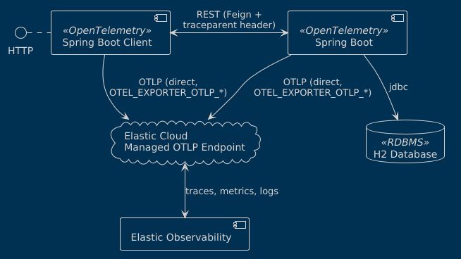

# Elastic Spring Boot mOTLP POC

## Components



## Configure Elastic Cloud

This branch sends all telemetry (traces, metrics and logs) directly to the
Elastic Cloud Managed OTLP endpoint; no collector or local stack is needed.
Export the endpoint and API key before starting the applications (for example
from a `.env` file, which must not be committed):

```bash
export OTEL_EXPORTER_OTLP_ENDPOINT="https://<motlp-endpoint>:443"
export OTEL_EXPORTER_OTLP_HEADERS="Authorization=ApiKey <api-key>"
```

Then execute the two applications on their respective directories with

* springboot-demo (8080 port)

```bash
cd springboot-demo
mvn spring-boot:run
```

* springboot-client-demo (8081 port)

```bash
cd springboot-client-demo
mvn spring-boot:run
```

## Useful curl instructions

CPU load test
```bash
curl http://localhost:8080/fibo\?n\=45
```

Log test
```bash
curl http://localhost:8080/log
```

Trace test
```bash
curl http://localhost:8081/trace-demo
```

## Consumer telemetry

Both services use `opentelemetry-spring-boot-starter`, configured with `otel.*`
properties and the `OTEL_EXPORTER_OTLP_*` variables above.

The starter does not instrument OpenFeign, so
`FeignTracingConfig` registers a Feign `RequestInterceptor` that injects the
current trace context (`traceparent`) into outgoing requests. This links the
client's `/trace-demo` span with the provider's `/books` span in one trace.

Call `/trace-demo` with both services running, then inspect the trace in
Elastic Observability (APM > Traces).
